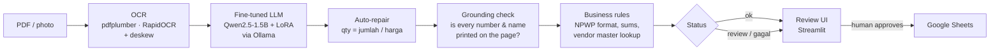

# DokuAgent

**Local, fine-tuned document AI that turns Indonesian supplier invoices and expense receipts into structured data — and knows when it is wrong.**

OCR → fine-tuned Qwen2.5-1.5B (QLoRA) → business-rule validation & grounding checks → human review UI → Google Sheets.
Runs fully offline on an 8 GB MacBook Air; no document ever leaves the machine.

> 📹 **Demo (3 min):** _[link video]_ · 🤗 **Model:** _[link Hugging Face]_


---

## The problem

> _PT Sumber Makmur is a fictional client. The scenario and numbers are modelled on a typical Indonesian distributor's finance team._

The finance team receives **~500 supplier invoices per month** (emailed PDFs and phone photos of paper invoices) plus employee **expense receipts** for reimbursement. Each document is typed into a spreadsheet by hand — about **4 minutes per invoice (~33 hours/month)** — and typos in NPWP (tax ID) and totals are only caught at month-end reconciliation.

Constraints gathered during discovery ([`docs/discovery.md`](docs/discovery.md)):

- Financial documents **must not be sent to third-party APIs** → the model must run locally.
- Must run on ordinary office hardware (no GPU).
- Output must land in the **Google Sheet the team already uses**.
- Wrong numbers are worse than slow numbers → every uncertain result must be flagged for a human.

## What DokuAgent does



Two document modes, chosen by the user:

| Mode | Fields | Typical source |
|---|---|---|
| **Invoice pemasok** (supplier invoice) | invoice no., date, seller, seller NPWP, buyer, line items, subtotal, VAT, total | B2B PDFs and scans |
| **Struk reimbursement** (expense receipt) | line items, subtotal, tax, total | Restaurant / minimarket receipts |

## Results

### The journey: every gain came from a different decision

Measured on **60 held-out synthetic invoices whose company and product names never appear in training**, plus **50 real Indonesian receipts** from the CORD dataset.

| Version | Change | Invoices: line items F1 | Invoices: all header fields | Real receipts: line items F1 | Real receipts: total |
|---|---|---|---|---|---|
| Baseline | Qwen2.5-1.5B-Instruct, prompt only | 40.9% | 87.9% | 43.2% | 50.0% |
| v1.0 | QLoRA fine-tune on 480 synthetic invoices | 87.3% | 96.5% | **27.8%** ⚠️ | 42.0% |
| v1.1 | Fix OCR row grouping (deskew) | 95.6% | 96.5% | – | – |
| v1.2 | Correct seller name via NPWP → vendor master | 95.6% | **99.0%** | – | – |
| **v2.0** | **Retrain with +100 real receipts; separate invoice / receipt modes** | **96.0%** | **98.8%** | **56.7%** | **74.0%** |

All money fields (subtotal, VAT, total) and NPWP are **100% correct** on the invoice test set from v1.0 onward.
Latency: ~3 s per receipt, ~7–9 s per invoice (p50) on a MacBook Air M-series, 8 GB RAM, CPU/Metal only.

**The most important row is v1.0.** Fine-tuning on synthetic data made the model *better* on synthetic invoices and *worse than the untouched base model* on real receipts (27.8% vs 43.2%). The model had memorised one layout and learned to always fill every field — so on receipts with no NPWP or invoice number, it invented them. I only found this because I built a real-world test set before calling the project done. Adding 100 real receipts (oversampled ×2) and giving receipts their own schema fixed it without hurting invoice accuracy.

### Safety layer: catching errors instead of hiding them

A model that is right 96% of the time is dangerous if the 4% look exactly like the 96%. Every result is checked against the OCR text of the document itself:

| Check | What it catches | Measured |
|---|---|---|
| **Grounding: numbers & items** | Line items or totals that are not printed anywhere on the document (hallucinations) | Caught **60/60** simulated hallucinations; **1/60** false alarms on correct answers |
| **Grounding: header fields** | Invented seller/buyer names, invoice numbers, NPWP | Caught **60/60**; **0/60** false alarms |
| Business rules | qty × price ≠ amount, items ≠ subtotal, subtotal + VAT ≠ total, bad NPWP format | — |
| Vendor master (NPWP) | Misspelled seller names from OCR noise; unknown suppliers | Seller-name accuracy 76.7% → **96.7%**; unknown NPWP flagged as "new supplier" |
| Auto-repair | Quantity column read as amount (e.g. qty 57,000 instead of 1) | Repaired and flagged for review |

Grounding is tolerant to typical OCR misreads (`12.962:500`, `70o,o0`, `22i`) — before adding that tolerance, it raised false alarms on **21 of 30** scanned invoices; after, on **1 of 60**.

The UI shows one of three states: ✅ all checks passed, 🟡 needs human review (with reasons), 🔴 **result not trustworthy — enter manually**.

## Key engineering decisions

**Local small model instead of a cloud API.** The client's constraint was data privacy. A 1.5B model quantised to 4-bit (≈1 GB) runs on a laptop; fine-tuning closes most of the gap to larger models on this narrow task.

**Honest test set.** The synthetic generator uses *disjoint vocabularies* for train and test (company names, products), so the score measures reading ability, not memorisation. The real-world CORD set is evaluated separately and never mixed into the headline numbers.

**Error analysis before more training.** Every improvement after v1.0 came from reading individual failures:
- 22 of 23 invoice errors were on scanned images → traced to *my* OCR line-grouping code collapsing whole tables into one line on images tilted by 1–2°. Fix: estimate skew from text boxes and straighten coordinates before grouping. Row integrity on scans went from **77.9% → 95.6%**, and line-item F1 from 87.3% → 95.6% **with no retraining**.
- Seller names failed on unseen names because OCR misspelled them and the model copied the typo. NPWP, however, was read 100% correctly → look the name up in the vendor master by NPWP instead of trusting OCR.

**A bug worth keeping in the story.** One iteration added a fallback model when the primary output failed grounding, choosing "whichever answer has fewer grounding problems." The fallback returned item names with **no numbers at all** — zero numbers, zero mismatches — and won. Classic metric gaming: I optimised "fewest detectable errors" instead of "correct and complete". Fixed by requiring a fallback answer to be complete and to pass grounding before it may replace the primary one; the fallback is now off by default.

## Limitations (known and measured)

- **Handwritten notes are out of scope.** OCR cannot read them reliably; the system detects this through failed grounding and shows the 🔴 state rather than guessing. Supporting them would need a vision-language model (e.g. `Qwen2.5-VL-3B`).
- **Minimarket receipts with abbreviated item names** (Indomaret/Alfamart style, e.g. `P/C BISCOFF MLKCHESE`) are still often misread — the real-receipt training data (CORD) is mostly restaurants. These errors *are* flagged. Fix: collect and label 30–50 minimarket receipts via the review UI and train v3.
- **Small real-world test set (50 receipts):** one receipt ≈ 2 percentage points; small differences are not significant.
- **Unusual table layouts** (e.g. quantity column first) can confuse the model; auto-repair fixes the common case, a broader generator would fix the cause.
- **Vendor master is simulated** from labels; in production it would come from the client's accounting/ERP system. 10% of suppliers were deliberately left out to exercise the "new supplier" path.
- **OCR-confidence threshold** for "hard to read" was calibrated on very few samples and proved unreliable on a real handwritten photo; grounding is the primary safeguard.
- **Sheets output repeats invoice-level fields on every item row.** Convenient for pivots, risky for summing totals; in a real deployment the format would be agreed with the finance team (e.g. separate `Invoices` and `Items` sheets).

## Quickstart

Requirements: Python 3.11+, [Ollama](https://ollama.com), ~3 GB free disk.

```bash
git clone https://github.com/tiarafitr/dokuagent.git && cd dokuagent
python -m venv .venv && source .venv/bin/activate
pip install -r requirements.txt

# model: download the GGUF from Hugging Face into models/, then
cd models && ollama create dokuagent-v2 -f Modelfile.v2 && cd ..

# run
uvicorn app.main:app --reload          # API  → http://localhost:8000/docs
streamlit run app/ui.py                 # UI   → http://localhost:8501
```

Optional configuration (environment variables):

| Variable | Purpose |
|---|---|
| `SHEET_ID` | Google Sheet to append approved results to (share it with your service account) |
| `GOOGLE_SA_JSON` | Path to the service-account key (default `service_account.json`, git-ignored) |
| `EXTRACT_MODEL` | Ollama model name (default `dokuagent-v2`) |
| `FALLBACK_MODEL` | Optional larger model tried only when the primary result fails, e.g. `qwen2.5:7b` (needs ≥16 GB RAM) |

## Reproduce the results

```bash
python scripts/generate_invoices.py --n 600          # synthetic invoices (seed 42)
python scripts/build_sft_dataset.py                  # OCR + chat-format training data
python scripts/build_vendor_master.py                # simulated vendor master
pip install datasets
python scripts/import_cord.py --train 100 --test 50  # real receipts (CORD, CC-BY-4.0)

# fine-tune: notebooks/finetune_qwen_unsloth.ipynb on a free Colab T4 (~15–20 min)

python scripts/evaluate.py --models qwen2.5:1.5b-instruct dokuagent-v2 --vendor          # invoices
python scripts/evaluate.py --models qwen2.5:1.5b-instruct dokuagent-v2 --data data/real  # receipts
python scripts/error_analysis.py --model dokuagent-v2 --limit 60
```

Training setup: Unsloth + TRL, QLoRA (r=16, all linear layers), 3 epochs, lr 2e-4, effective batch 16, loss on assistant tokens only; 480 synthetic invoices + 100 CORD receipts (×2). Exported to GGUF Q4_K_M.

## Project structure

```
app/
  ocr.py          OCR with deskewed line grouping + confidence summary
  extractor.py    LLM call via Ollama, per-document-type prompts
  schemas.py      output schemas and prompts (invoice / receipt)
  validator.py    business rules, grounding checks, auto-repair
  vendor.py       NPWP → vendor-master lookup
  main.py         FastAPI: /extract, /push, /stats, /health
  ui.py           Streamlit review UI
  sheets.py       Google Sheets integration
scripts/          data generation, CORD import, evaluation, error analysis
notebooks/        Colab fine-tuning notebook
docs/             discovery notes, evaluation results, loss curves
models/           Ollama Modelfiles (GGUF weights are not committed)
```

## Stack

Qwen2.5-1.5B-Instruct · Unsloth · TRL · PEFT (QLoRA) · llama.cpp / GGUF · Ollama · RapidOCR · pdfplumber · FastAPI · Streamlit · gspread

## Credits

- Base model: [Qwen2.5-1.5B-Instruct](https://huggingface.co/Qwen/Qwen2.5-1.5B-Instruct) (Apache 2.0).
- Real receipts: **CORD** — Park et al., *CORD: A Consolidated Receipt Dataset for Post-OCR Parsing*, NeurIPS Workshop 2019, [naver-clova-ix/cord-v2](https://huggingface.co/datasets/naver-clova-ix/cord-v2), CC-BY-4.0.
- Fine-tuning: [Unsloth](https://github.com/unslothai/unsloth).

## Next steps

1. Collect 30–50 minimarket receipts via the review UI (human-corrected labels) and train v3.
2. Broaden the invoice generator: quantity-first columns, "Banyaknya / Nama Barang" headers, cash-note templates.
3. Agree on the Sheets format with the finance team; add an approval log for audit.
4. Docker Compose for one-command deployment on an office server.
5. Evaluate a vision-language model for handwritten notes.
